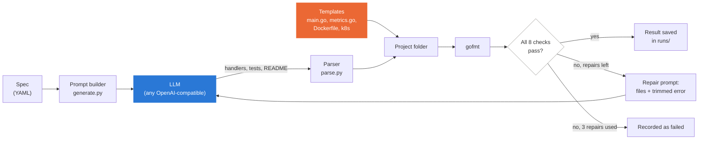

# Spec-to-Service

A small Python tool that takes a short YAML description of an infrastructure service, asks an LLM to write the Go handlers, tests and docs, and then **checks its own output** instead of trusting it. The server wiring, metrics, Dockerfile and Kubernetes files come from fixed templates, so the model only writes what actually varies.

It was built to answer one question with measured numbers: **how often does LLM-generated service code actually work, and what does the model get wrong?**

It generates single-process Go services using only the standard library plus Prometheus. The orchestrator is plain Python with no agent framework. It was built in about two days, and the models tested are hosted ones, not self-hosted.

## The short version

You give it a spec like "a job queue with `POST /jobs`, `GET /jobs`, and a queue-length metric". It writes the service, starts it, and tests it like a customer would.

- **The model alone is unreliable.** `nemotron-ultra` passes every check on its first try in **20.0%** of dev specs and **6.7%** of held-out specs.
- **With checking and repair it gets there.** Feeding each failure back for up to 3 repairs reaches **93.3%** on dev and **86.7%** on held-out.
- **The failures are mostly small.** Compile and vet slips, wrong imports, and messy formatting. The model can't line up whitespace reliably, so a deterministic `gofmt` step handles that.
- **The held-out specs were frozen before any run** and never used for tuning.

These numbers come from one model and 15 specs, run 3 times each (30 dev runs, 15 held-out runs). First-try rates varied between trials, from 10.0–30.0% on dev and 0.0–20.0% on held-out. They are generated from `results/` by script. See [Results](#results).

## How it works



Take `specs/dev/gpu-job-watcher.yaml`, a service that tracks GPU jobs:

1. The **spec** lists the endpoints (`POST /jobs`, `GET /jobs`), the metrics (`gpu_job_queue_length`), and a few **probes**, such as "a POST with no `id` must return 400".
2. The **templates** produce the parts that never change: the server, `/health`, `/metrics`, the Dockerfile and the Kubernetes files.
3. The **LLM** writes `handlers.go` (the logic), `handlers_test.go` and `README.md`.
4. The **verifier** builds the project, starts the server on a free port and talks to it over HTTP.
5. If a check fails, the failing stage and the last ~60 lines of error go back to the LLM, which returns corrected files. This repeats up to 3 times.

In one real run (`runs/m3-smoke/`), the model's first answer compiled and passed `vet`, but one of its own tests hung for 46 seconds. The verifier recorded that as a `timeout` at the `test` stage, sent the error back, and the repaired code passed everything.

## Architecture

```
specgen/
  __main__.py, cli.py     entry point and commands (generate, verify, eval, report, demo, freeze)
  spec.py                 loads and validates a YAML spec
  generate.py             prompts, template rendering, gofmt step
  parse.py                turns the LLM's answer into files; rejects unsafe file names
  repair.py               run_spec(): generate -> verify -> repair loop for one spec
  evalrun.py              runs many specs x models, owns the held-out freeze
  report.py               reads runs/, writes results/summary.md and summary.json
  demo.py                 one spec end to end with live output
  llm/
    base.py               the one interface every model must fit; optional dev cache
    openai_compat.py      one client for NVIDIA, Gemini, vLLM, Ollama
    mock.py               fake model for offline tests (always labeled as mock)
    ratelimit.py          requests-per-minute limiter and retry backoff
  verify/
    pipeline.py           runs the 8 checks in order, stops at the first failure
    common.py             result type and safe subprocess runner (timeouts, process-group kill)
    go_checks.py          format, build, vet, test
    probes.py             starts the service and checks it over HTTP
    docs_check.py         compares the README with what really exists
    manifests.py          checks Dockerfile and Kubernetes YAML
templates/                fill-in-the-blank files (Go server, metrics, Dockerfile, k8s, Makefile)
specs/dev/                10 specs used while tuning prompts
specs/heldout/            5 specs, frozen in specs/HELDOUT.lock before the first eval
models.yaml               model configs (address, model id, key variable name, rate limit)
runs/                     raw evidence per run: prompts, answers, generated code, results
results/                  generated summaries only (never edited by hand)
tests/                    pytest tests for the tool itself
scripts/check_env.py      checks Python, Go, optional tools and which keys are set
```

Everything the model produces is saved. For any run you can open `runs/<run>/<model>/<spec>/t1/` and see `calls.jsonl` (every prompt and answer), `project/` (the generated code) and `result.json` (what passed, what failed, why).


## The verifier

Eight checks, run in order. The first failure stops the run and gives it a label, which is how the report counts "what fails most".

| # | Check | What it does | Failure label |
|---|---|---|---|
| 1 | parse | Is the answer in the expected file format, with safe file names? | `parse_error` |
| 2 | format | Does `gofmt -l` list nothing? | `format` |
| 3 | build | Third-party imports rejected, then `go build` | `compile_error` |
| 4 | vet | `go vet` finds suspicious code | `vet` |
| 5 | test | At least 3 test functions, then `go test` | `test_failure`, `no_tests`, `timeout` |
| 6 | probe | Starts the binary. `/health` returns 200, every declared metric is on `/metrics`, every endpoint answers, and the spec's `probes` get the expected status | `probe_health`, `probe_metrics`, `probe_endpoint`, `probe_behavior` |
| 7 | docs | Every spec endpoint and metric is in the README, and everything the README lists really exists | `docs_mismatch` |
| 8 | manifests | YAML sanity checks, plus `hadolint` and `kubeconform` when installed | `manifest_error` |

Two things worth knowing:

- **The model writes its own tests, so they aren't enough.** They can agree with a wrong handler. That's why checks 6 and 7 use things the model did not write: the spec's probes and the real running service.
- **A skipped check is never a pass.** If `hadolint` or `kubeconform` isn't installed, the report lists it under "Skipped checks".

Everything runs with timeouts (build 120s, tests 60s, probes 20s) in its own process group that is killed afterwards. This is **not** a hardened sandbox; the generated code runs on your machine.

## The repair loop

When a check fails, `repair.py` sends the model the spec, its current files, the failing stage and category, and the last ~60 lines of the error. It asks for corrected files and applies them over the current ones. This repeats up to 3 times, and every prompt and answer goes into `calls.jsonl`.

A repair can't cheat by deleting tests. If it lowers the number of distinct test functions, its test files are reverted to the originals (its other fixes still apply), and the attempt is flagged.

Two terms the report uses:

- **pass@1**: passed every check on the first try, with no repair.
- **pass after repair**: passed within 3 repairs.

## What the model writes vs. what templates write

| Written by the model | Written by templates |
|---|---|
| `handlers.go`: the logic behind each endpoint | `main.go`: server, graceful shutdown, `/health`, `/metrics` |
| `handlers_test.go`: its own tests | `metrics.go`: one Prometheus variable per metric in the spec |
| `README.md` | `Dockerfile`, `k8s/deployment.yaml`, `k8s/service.yaml`, `Makefile` |

The model is never allowed to write the template-owned files; the parser rejects an answer that tries. This keeps the boilerplate correct by construction, so failures measure the model's real work. The generated services keep their data in memory, inside each running copy. Running two copies behind a Kubernetes Service would therefore give inconsistent data; a real deployment would need shared storage.

## The 15 specs

Ten **dev** specs were used while tuning the prompts. Five **held-out** specs were frozen first and never tuned on. They range from simple CRUD to services with concurrency, background loops and non-trivial logic. "Checks" counts the endpoints, metrics and spec probes the verifier tests.

| Spec | Set | What it builds | Checks | Passed first try | Passed after repair |
|---|---|---|---|---|---|
| `config-diff` | dev | Compares two flat configuration maps and returns a structured diff. | 1 endpoint + health/metrics, 2 metrics, 3 probes | 0 of 3 | 3 of 3 |
| `config-validator` | dev | Validates service configs submitted as JSON and reports every rule violation. | 1 endpoint + health/metrics, 2 metrics, 4 probes | 1 of 3 | 3 of 3 |
| `disk-usage-exporter` | dev | Reads filesystem statistics and exposes them over HTTP and as metrics. | 1 endpoint + health/metrics, 2 metrics, 3 probes | 1 of 3 | 3 of 3 |
| `feature-flag-service` | dev | Stores feature flags with percentage rollout and evaluates them per user. | 4 endpoints + health/metrics, 2 metrics, 6 probes | 0 of 3 | 3 of 3 |
| `gpu-job-watcher` | dev | Tracks GPU jobs in memory and exposes queue length and GPU utilization. | 2 endpoints + health/metrics, 2 metrics, 3 probes | 1 of 3 | 3 of 3 |
| `job-queue-api` | dev | A FIFO job queue with enqueue, dequeue and acknowledge. | 3 endpoints + health/metrics, 3 metrics, 6 probes | 0 of 3 | 3 of 3 |
| `log-aggregator` | dev | Ingests log lines and counts them by level. | 2 endpoints + health/metrics, 3 metrics, 4 probes | 2 of 3 | 2 of 3 |
| `node-heartbeat-monitor` | dev | Nodes post heartbeats; a node is stale if it has not been heard from recently. | 3 endpoints + health/metrics, 2 metrics, 5 probes | 0 of 3 | 3 of 3 |
| `ttl-cache-service` | dev | An in-memory key-value cache where entries expire after a TTL. | 3 endpoints + health/metrics, 3 metrics, 7 probes | 1 of 3 | 3 of 3 |
| `webhook-relay` | dev | Accepts webhook requests and forwards them to a target URL with retries. | 2 endpoints + health/metrics, 3 metrics, 4 probes | 0 of 3 | 2 of 3 |
| `alert-rule-evaluator` | heldout | Stores threshold alert rules and evaluates submitted metric values against them. | 3 endpoints + health/metrics, 3 metrics, 5 probes | 0 of 3 | 2 of 3 |
| `artifact-registry-metadata` | heldout | Stores metadata (not the blobs) for versioned build artifacts. | 4 endpoints + health/metrics, 2 metrics, 7 probes | 1 of 3 | 3 of 3 |
| `cluster-inventory-api` | heldout | Registers cluster nodes with labels and lists them filtered by label. | 3 endpoints + health/metrics, 2 metrics, 7 probes | 0 of 3 | 3 of 3 |
| `rate-limiter-service` | heldout | A token-bucket rate limiter keyed by client. | 2 endpoints + health/metrics, 3 metrics, 9 probes | 0 of 3 | 3 of 3 |
| `task-scheduler-status-api` | heldout | Stores cron-like schedules and computes their next run time. | 3 endpoints + health/metrics, 2 metrics, 7 probes | 0 of 3 | 2 of 3 |

The last column counts, out of the runs each spec got, how many passed every check on the first try and how many passed after repair (up to 3 repairs).


## Setup

You need Python 3.10+ and Go 1.22+. `docker`, `hadolint` and `kubeconform` are optional.

```bash
python3 -m pip install -r requirements.txt
cp .env.example .env        # then put your key(s) in .env; it is git-ignored
python3 scripts/check_env.py
```

Keys are read from environment variables (`NVIDIA_API_KEY`, `GEMINI_API_KEY`, optional `ANTHROPIC_API_KEY`). They are never printed or stored in code.

## Running things

**Try it with no API key** (a fake model, clearly labeled in the output):

```bash
MODEL=mock-flaky make demo
```

**Generate one service with a real model:**

```bash
python3 -m specgen generate specs/dev/gpu-job-watcher.yaml --model nemotron-ultra
```

**Run it yourself.** The generated project is in `out/<spec>/project`:

```bash
PORT=8080 ./svc.bin
curl localhost:8080/health
```

**Run an evaluation, then build the report:**

```bash
python3 -m specgen eval --models nemotron-ultra --split dev --trials 1 --run-id dev-3
python3 -m specgen report --run-id dev-3
```

**Test the tool itself:**

```bash
python3 -m pytest tests -q
```

**The held-out set.** `specgen freeze` records the SHA-256 of each held-out spec in `specs/HELDOUT.lock`. `eval` refuses to run held-out specs if any file changed.

## Results

Runs included: dev-3, heldout-1 · real-model runs: 45 · mock runs: 0 · gofmt autoformat applied to model code: yes · response cache on: False · prompt/repair code fingerprints: 038221c78182

### Dev set (used while tuning prompts)

| model | runs | pass@1 | pass after repair (≤3) | mean repairs | mean tokens | mean time (s) | pass@1 range over trials (%) |
|---|---|---|---|---|---|---|---|
| nemotron-ultra | 30 | 20.0% | 93.3% | 1.23 | 11200 | 134.25 | 10.0–30.0 |

### Held-out set (frozen before the first eval; never tuned on)

| model | runs | pass@1 | pass after repair (≤3) | mean repairs | mean tokens | mean time (s) | pass@1 range over trials (%) |
|---|---|---|---|---|---|---|---|
| nemotron-ultra | 15 | 6.7% | 86.7% | 1.87 | 18684 | 197.31 | 0.0–20.0 |

### First-failure categories per model (runs that did not pass at attempt 0)

| model | compile_error | docs_mismatch | format | parse_error | probe_health | test_failure | timeout | vet |
|---|---|---|---|---|---|---|---|---|
| nemotron-ultra | 15 | 2 | 3 | 1 | 1 | 3 | 1 | 12 |

### What the repair loop fixed vs. could not

**Fixed by the repair loop**

- `nemotron-ultra` / `config-diff` (dev, trial 1): attempt 0: build/compile_error → attempt 1: PASS  
  trace: `runs/dev-3/nemotron-ultra/config-diff/t1/calls.jsonl`
- `nemotron-ultra` / `config-diff` (dev, trial 2): attempt 0: build/compile_error → attempt 1: PASS  
  trace: `runs/dev-3/nemotron-ultra/config-diff/t2/calls.jsonl`
- `nemotron-ultra` / `config-diff` (dev, trial 3): attempt 0: build/compile_error → attempt 1: PASS  
  trace: `runs/dev-3/nemotron-ultra/config-diff/t3/calls.jsonl`

**Not fixed within 3 repairs**

- `nemotron-ultra` / `log-aggregator` (dev, trial 3): attempt 0: probe/probe_health → attempt 1: test/test_failure → attempt 2: probe/probe_health → attempt 3: test/test_failure  
  trace: `runs/dev-3/nemotron-ultra/log-aggregator/t3/calls.jsonl`
- `nemotron-ultra` / `webhook-relay` (dev, trial 1): attempt 0: parse/parse_error → attempt 1: format/format → attempt 2: build/compile_error → attempt 3: probe/probe_health  
  trace: `runs/dev-3/nemotron-ultra/webhook-relay/t1/calls.jsonl`


### Limitations

- Small n: 15 specs, 1–3 trials per spec per model; differences of a few points are noise.
- Free-tier / hosted models only unless a `local` model appears in the tables above (it is untested otherwise).
- The verifier is my own: probes check status codes and metric names, not response bodies, so a pass is not proof of full correctness.
- Endpoints with path parameters may legitimately 404, so a missing route there is only caught by spec `probes` or generated tests.
- Dev specs were used to tune prompts; held-out specs were frozen first and not tuned on. Both sets were written by me, not sampled from real workloads.
- Generated code runs unsandboxed on the host (timeouts and process-group kill only).
- Not tested here: docker build, hadolint, kubeconform, any real cluster, self-hosted models.

## Limitations

- **Small sample.** One model, 15 specs, one trial each. A single spec moves the held-out number by 20 points.
- **Hosted models only.** No self-hosted model was run. The `local` entry in `models.yaml` is an untested example.
- **Path-parameter endpoints.** A route like `/jobs/{id}` can legitimately return 404, so a missing route there is only caught by a spec probe.
- **The model sees the spec's probes in its prompt**, so a pass shows instruction following, not guessing hidden requirements.
- **Not tested:** `docker build`, any real Kubernetes cluster, concurrent load, or self-hosted inference. Nothing here is claimed to be production-ready.

## Future work (not built)

- Use verified generations as training data, or for rejection sampling, on a self-hosted model.
- Point the model layer at a vLLM or Ollama server on local GPUs.
- More trials and more models for tighter numbers.
- Check response bodies in probes, not just status codes.
- More languages, and CI integration.
